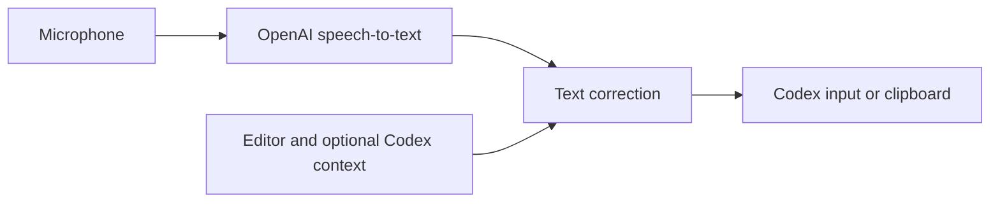

# IDEA ChatGPT Dictate

[](https://github.com/ilinic/IDEA_ChatGPT_Dictate/actions/workflows/build.yml)


**Voice dictation for Codex inside IntelliJ IDEA — multilingual speech recognition with context-aware correction of programming terminology.**

IDEA ChatGPT Dictate **1.0** is a lightweight IntelliJ IDEA plugin that turns spoken instructions into editable prompts in the **Codex chat input**. It uses OpenAI speech-to-text, then corrects transcription mistakes using the source code context from your current IDE project. The plugin **never presses Enter or sends the chat message for you**.

[Русская версия README](README.ru.md) · [Download a build](https://github.com/ilinic/IDEA_ChatGPT_Dictate/actions/workflows/build.yml) · [Source code](https://github.com/ilinic/IDEA_ChatGPT_Dictate)

## Why use it?

- **Speak naturally while coding.** Choose one or more recognition languages or let OpenAI detect them automatically. Mix technical identifiers and ordinary speech.
- **Context-aware technical correction.** The correction step can see the project name, open file, caret position, Java class/method and a short selection preview.
- **Optional Codex conversation context.** Include the last 2, 4, 8 or 16 messages only if the IDE can identify the precise Codex session ID. Matching project directories alone are never enough.
- **One configurable F1–F12 key.** Press once to start recording, once more to stop.
- **One localized settings window.** API key, keyboard shortcut, recognition languages, correction model and optional context are configured together. Russian and English interfaces follow the IDE UI locale.
- **Quiet status updates.** Recording and processing progress is shown in IntelliJ IDEA's status bar, not in intrusive balloons.
- **Safe insertion.** When the original input loses focus, transcription goes to the clipboard instead of being pasted into source code.

## Quick start

### 1. Install the plugin

**Download the ready-made ZIP:**

1. Open [Build IntelliJ Plugin — GitHub Actions](https://github.com/ilinic/IDEA_ChatGPT_Dictate/actions/workflows/build.yml).
2. Open the latest **successful** workflow run and download the `idea-chatgpt-dictate` artifact.
3. Extract the downloaded artifact archive. It contains the actual installable plugin ZIP.
4. In IntelliJ IDEA go to **Settings → Plugins → ⚙ → Install Plugin from Disk**, select the plugin ZIP and restart IDEA if prompted.

Or build it yourself with **JDK 21**:

```powershell
git clone https://github.com/ilinic/IDEA_ChatGPT_Dictate.git
cd IDEA_ChatGPT_Dictate
.\gradlew.bat buildPlugin
```

The installable ZIP is produced in `build/distributions/`. Set `JAVA_HOME` to the JDK directory (not the `bin` subdirectory).

### 2. Configure the plugin

Open **Tools → IDEA ChatGPT Dictate → Settings...** (or **Настройки…** in a Russian-language IDE).

| Setting | What it does |
| --- | --- |
| **OpenAI API key** | Stored using IntelliJ Password Safe and displayed as masked dots. Clear the field and save to delete the stored key. If configured, the `OPENAI_API_KEY` environment variable remains a fallback. |
| **Hotkey** | Choose one key from **F1–F12**. If another IDE command already uses it, you are asked before replacing that shortcut. |
| **Text correction model** | Choose the model used to fix recognized text. **GPT-6 Luna** is the default low-cost option. |
| **Recognition languages** | Multi-select from 14 languages, default Russian and English. Clear the selection for automatic language detection. |
| **Use Codex chat context when available** | Opt in/out of recent chat history; enabled by default. The plugin must verify the exact session ID, otherwise it sends no chat history. |
| **Recent context length** | Choose the most recent **2, 4, 8 or 16 messages**, default eight. |

Available correction models: `gpt-6-luna` (default), `gpt-6.1-terra`, `gpt-6.1-sol` and `gpt-6-astra`. Speech recognition uses `gpt-transcribe` independently of this selection.

**Note:** The OpenAI Platform API is billed separately from ChatGPT Plus. A ChatGPT subscription is not an API key.

### 3. Dictate into Codex

1. Open your project and, optionally, a relevant source file.
2. Place the cursor in the **Codex chat composer**.
3. Press your chosen F key to **start** speaking.
4. Press the same key to **stop**; wait for transcription and correction.
5. Review or edit the inserted text, then send it yourself when ready.

You can also use **Tools → IDEA ChatGPT Dictate → Start / Stop Dictation**. Each recording is limited to **120 seconds**.

## How it works



1. Java Sound captures mono audio into an in-memory WAV file.
2. `gpt-transcribe` recognizes speech in the selected languages, with project-specific technical hints.
3. The selected GPT text model corrects obvious transcription errors, punctuation and identifiers. It is instructed **not** to answer or expand the prompt.
4. The result is pasted into the original focused component. If focus changed, the plugin puts the text on the clipboard and asks you to paste it manually.

If correction fails while speech recognition succeeded, the **raw transcript** is retained rather than discarded.

## Privacy and permissions

- **No background recording.** Microphone capture begins only when explicitly activated.
- **No temporary audio files.** Audio is buffered in memory and sent to OpenAI only for transcription.
- **Limited code context.** The plugin may send the current project path, source-file location, PSI class/method information and a short selection preview, **not the whole repository**.
- **Codex history is conditional.** If enabled, a recent excerpt is used only when the IDE process exposes a valid `CODEX_THREAD_ID` or `CODEX_SESSION_ID`, and that ID matches a local session belonging to the project. These variables are commonly available to a Codex agent subprocess **but not to IntelliJ itself**; in that case no chat history is sent. An active IDE chat cannot be reliably inferred from directory and timestamps alone. You can disable the feature at any time.
- **No automatic chat submission.** The plugin does not press Enter.
- **No progress popups.** Status messages are always shown in the IDE status bar; warnings and errors are also kept in the event log without balloons.
- **Key storage.** The API key is stored in IntelliJ Password Safe; an `OPENAI_API_KEY` environment variable can be used as a fallback. The key is not committed to Git.
- **API setting.** Text-correction requests use `store: false`. OpenAI's separate API data handling policies still apply.

## Compatibility and development

| Component | Requirement |
| --- | --- |
| IDE | IntelliJ IDEA, platform build **253+** (target **2025.3.3**) |
| Build JDK | Java **21** |
| Build system | Gradle Wrapper **9.1.0** |
| Language | Java, IntelliJ Platform SDK |
| Operating system | Developed and exercised on **Windows**; other platforms are not yet verified |
| API | OpenAI Platform key and network access |

The core dictation workflow has been tested with IntelliJ IDEA 2026.2 on Windows. Newer plugin changes still warrant an installation check.

```bash
./gradlew buildPlugin
```

GitHub Actions builds and uploads an installable ZIP on every push to `main`. Source files are under `src/main/java/nz/ilinic/ideadictate/`.

### Troubleshooting

- **No microphone input:** check the default Windows recording device and microphone privacy permissions for IntelliJ IDEA.
- **No transcription:** configure an OpenAI Platform API key and check API billing and network access.
- **The text appeared only on the clipboard:** put the cursor back into the Codex prompt and press `Ctrl+V`. The focus guard prevents accidental insertion into another editor.
- **F-key conflicts:** choose another F1–F12 key in Settings; IntelliJ warns before replacing a conflicting binding.
- **Wrong project terms:** open the relevant source file. The plugin uses its Java class/method and source selection context even if the current Codex chat cannot be identified.

## Project status

This is a working, independently developed IntelliJ IDEA plugin, not an official JetBrains or OpenAI product. Bug reports and reproducible issues are welcome via [GitHub Issues](https://github.com/ilinic/IDEA_ChatGPT_Dictate/issues).
